# 0.WSL2 — WSL2 安装与配置笔记

> 笔记涵盖WSL2的安装配置全流程：开启虚拟化与Hyper-V、升级内核、安装Ubuntu子系统、修改root密码与SSH、常用命令、备份还原、固定IP（改注册表DHCP网段并加开机脚本）、镜像网络模式与宿主机共用IP及防火墙放行。

> 来源：有道云笔记分享 · 原文参考 [CSDN 博客](https://blog.csdn.net/maomao_op/article/details/135932907)

[https://blog.csdn.net/maomao_op/article/details/135932907](https://blog.csdn.net/maomao_op/article/details/135932907)

### 系统要求

必须运行 Windows 10 版本 2004 及更高版本（内部版本 19041 及更高版本）或 Windows 11 才能使用以下命令。 如果使用的是更早的版本，请参阅[手动安装](https://learn.microsoft.com/zh-cn/windows/wsl/install-manual)

### 开启虚拟化

Hyper-V：由微软开发的虚拟化技术，它可以在 Windows 操作系统上创建和管理虚拟机

1. 按下 “Win + R” 组合键打开 “运行” 对话框，输入 “control” 并回车，打开 “控制面板”

2.将查看方式设置为 “大图标” 或 “小图标”，然后找到并点击 “程序和功能”，在左侧导航栏中点击 “启用或关闭 Windows 功能”

勾选：Hyper-V 、适用于linux 的Windows 子系统、虚拟平台

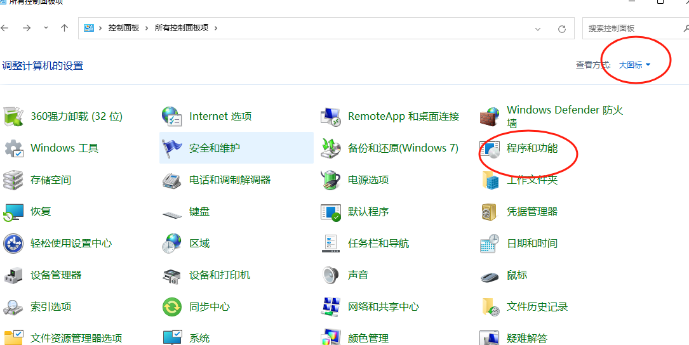

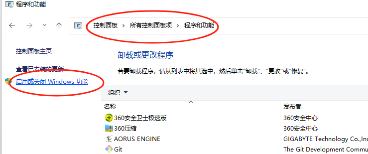

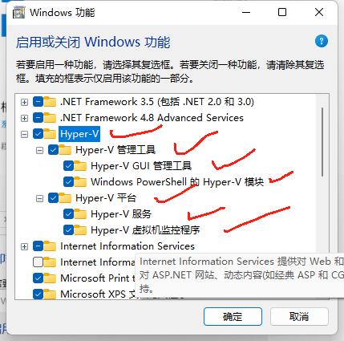

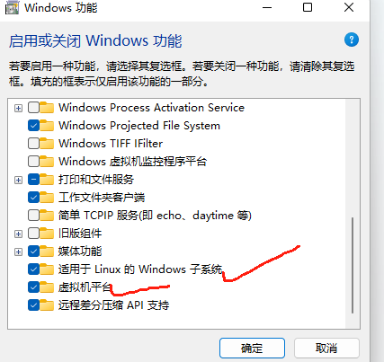

### 升级内核包

参考链接：[旧版 WSL 的手动安装步骤 | Microsoft Learn](https://learn.microsoft.com/zh-cn/windows/wsl/install-manual)

下载安装包： linux 内核包更新包

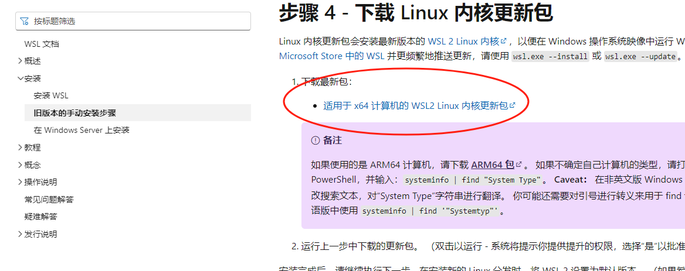

安装包如下：


### 检查版本

打开 powershell 执行以下命令，如果能显示证明已安装成功

```
wsl --version

# 查看可安装的子系统列表
wsl --list --online

# 安装指定版本
wsl --install -d Ubuntu-22.04
```

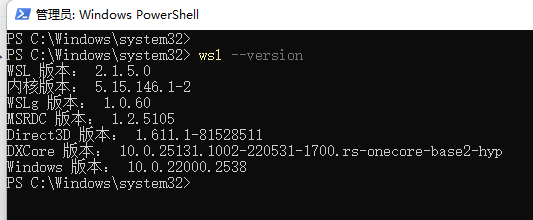

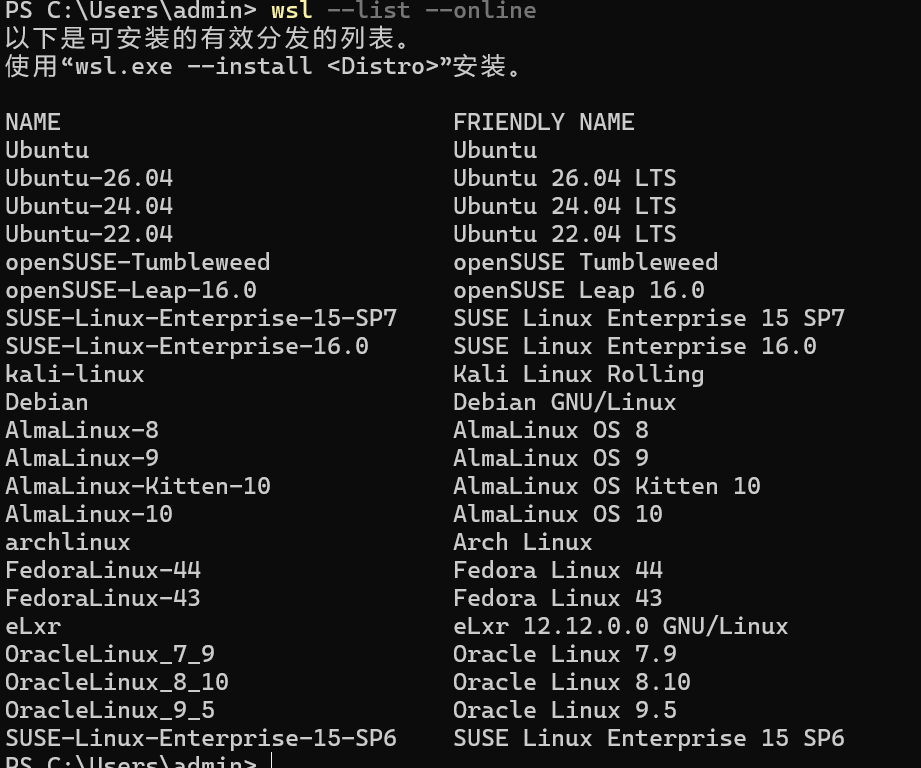

### 安装子系统

在Microsoft Store搜索Ubuntu，点击安装： 安装过程中会要求输入普通用户名和密码

[https://apps.microsoft.com/detail/9pn20msr04dw?hl=zh-cn&gl=CN](https://apps.microsoft.com/detail/9pn20msr04dw?hl=zh-cn&gl=CN)

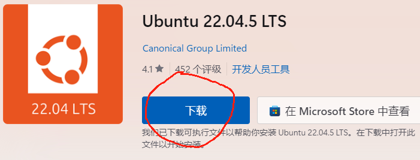

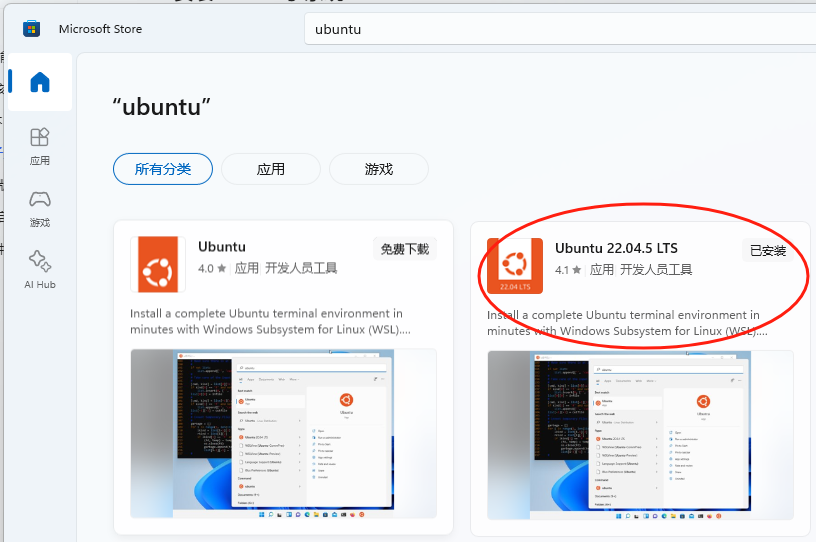

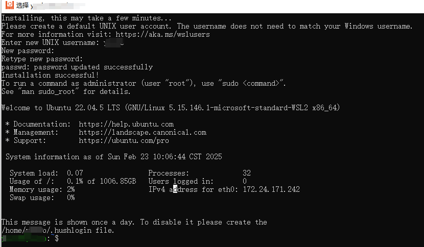

修改root密码（此步可忽略）

```
sudo passwd root
```

取消 sudo su 输入密码（此步可忽略）

```
# 执行命令
$ sudo visudo

找到如下行
%sudo   ALL=(ALL:ALL) ALL

修改为
%sudo   ALL=(ALL:ALL) NOPASSWD:ALL

按着Ctrl +X 退出 输入Y 回车保存
```

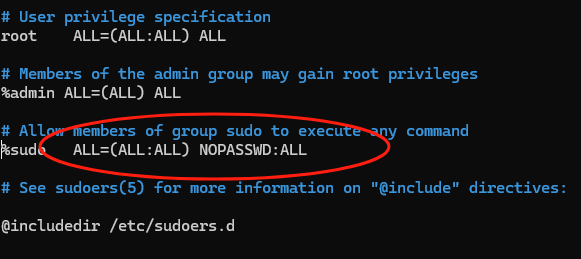

安装ssh 方便后面远程（此步可忽略）

```
apt-get update
apt install openssh-server
#查看ssh 状态
systemctl status ssh
#带一个配置防火墙配置工具，称为 UFW。如果防火墙在你的系统上被启用，请确保打开了 SSH 端口
sudo ufw allow ssh
#禁用SSH
sudo systemctl disable --now ssh

sudo vi /etc/ssh/sshd_config
PermitRootLogin yes （默认为#PermitRootLogin prohibit-password）
systemctl  restart ssh
```

### 常用命令

###### 查看子系统

```
wsl -l -v
```

###### 设置root 帐号

```
# 登陆 wsl 将user 部份修改成root
vi  /etc/wsl.conf

root@DESKTOP-HEM9LHH:~# cat /etc/wsl.conf
[boot]
systemd=true

[user]
default=root
```

###### 退出

```
wsl --shutdown
```

###### 登录

```
wsl

wsl -d Ubuntu-16.04
wsl -d Ubuntu-16.04 -u root
```

###### 注销

```
wsl --unregister Ubuntu-22.04
wsl --unregister Ubuntu-24.04
```

[https://www.cnblogs.com/yyd-sun/p/17764487.html](https://www.cnblogs.com/yyd-sun/p/17764487.html)

###### 查看版本

我的版本为 Ubuntu-22.04

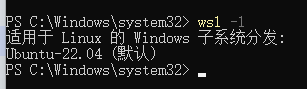

###### 备份

```
‘d://wslubuntu’ 是我的文件夹，需要导出前创建
‘Ubuntu’ 是我的版本，步骤一查询的
‘ubuntu-22.04.tar’是导出的文件自己命名即可，我的Ubuntu实际是22.04版本，linux内查询（lsb_release -a）

#导出命令

# 笔记本
wsl --export Ubuntu-22.04 D://wsl/backup//Ubuntu-22.04.tar

# 家
wsl --export Ubuntu-24.04 E://wsl//backup//ubuntu-24.04.tar
```

###### 还原

```
执行前需要创建d://wslubuntu//ubuntu 文件夹
'd://wslubuntu//ubuntu'  导入的位置，会产生一个 ext4.vhdx 硬盘映像文件
‘d://wslubuntu//ubuntu-22.04.tar’ 是导出镜像文件的路径
‘Ubuntu’ 是版本名

 #
wsl --import ubuntu-22.04  D://wsl//system//ubuntu-22.04  D://wsl//backup//Ubuntu-22.04.tar
wsl --import ubuntu-22.04  D://wsl//system//ubuntu-16.04  D://wsl//backup//Ubuntu-16.04.tar

# 家
wsl --import Ubuntu-24.04  E://wsl E://wsl//backup//ubuntu-24.04.tar

# 外贸公司
wsl --import Ubuntu-24.04  D://tool//wsl//system D://tool//wsl//backup//ubuntu-24.04.tar
```

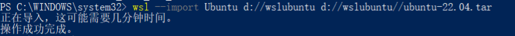

###### 固定IP

[https://mp.weixin.qq.com/s/-X_8waGrFDkYFQvDPqqzBg](https://mp.weixin.qq.com/s/-X_8waGrFDkYFQvDPqqzBg)

我的目标IP是：172.24.171.242

```
# 开启 Hyper-V
wsl --shutdown
dism /online /enable-feature /featurename:Microsoft-Hyper-V-All /all /norestart

# 在宿主机 windows 系统  执行
PS C:\Windows\system32> ipconfig

# 旧版默认 Hyper-V NAT 交换机，一般不再给 WSL 使用，IP：172.18.128.1，和你当前 WSL 无关
以太网适配器 vEthernet (Default Switch):
   连接特定的 DNS 后缀 . . . . . . . :
   本地链接 IPv6 地址. . . . . . . . : fe80::34e8:4d76:e705:e759%25
   IPv4 地址 . . . . . . . . . . . . : 172.18.128.1
   子网掩码  . . . . . . . . . . . . : 255.255.240.0
   默认网关. . . . . . . . . . . . . :

# 这个网卡就是 WSL 的 NAT 网关网卡
# IP：172.21.208.1，这个 IP 就是 WSL 虚拟机的默认网关 IP
# WSL 所有进出外网、访问 Windows 宿主机的流量都走这个网卡
以太网适配器 vEthernet (WSL (Hyper-V firewall)):
   连接特定的 DNS 后缀 . . . . . . . :
   本地链接 IPv6 地址. . . . . . . . : fe80::35e6:13a5:df6a:ba93%52
   IPv4 地址 . . . . . . . . . . . . : 172.21.208.1
   子网掩码  . . . . . . . . . . . . : 255.255.240.0
   默认网关. . . . . . . . . . . . . :
PS C:\Windows\system32> 能不能将wsl 网络的DHCP 分配IP 范围在： 172.24.0.0/16
```

WSL IP：172.24.171.242/16，网关 172.21.222.1 不在同一个网段，Linux 内核不允许直接把跨网段 IP 设为默认下一跳

网卡只是流量接口，真正分配 IP 的是 Windows 系统内置的 WinNAT + ICS 内部 DHCP 服务（属于 LxssManager 服务托管的系统内置 DHCP，没有独立可视化的 DHCP 程序）

1. WSL 开机后，虚拟机`eth0`发送 DHCP 广播请求

1. Windows 内置 ICS/DHCP 服务监听这个内部虚拟交换机

1. 从预设网段池（你当前：`172.21.208.0/20`）随机分配一个空闲 IP 给 WSL

1. 同时下发：网关 =`172.21.208.1`、DNS、子网掩码，也就是你这块虚拟网卡的 IP

172.24.171.242  与 172.21.208.1 不是同一个网段吗。为什么不能ping 通

一、先算两个网段，结论：完全不是同一个网段

1. 172.21.208.1 /20

子网掩码：255.255.240.0

网段范围：172.21.208.0 ~ 172.21.223.255

2. 172.24.171.242 /16

子网掩码：255.255.0.0

网段范围：172.24.0.0 ~ 172.24.255.255

两个网段第三段数字一个是21，一个是24，属于完全独立的内网网段，不在同一局域网，必须靠路由转发才能互通

先修改DHCP分配器

```
# 步骤 1：管理员 PowerShell 彻底关闭 WSL
wsl --shutdown

# 步骤 2：打开注册表（Win+R → 输入 regedit 回车）
HKEY_LOCAL_MACHINE\SOFTWARE\Microsoft\Windows\CurrentVersion\Lxss

# 步骤 3：新建 2 个【字符串值】
名称：NatNetwork，数值：172.24.0.0/16
名称：NatGatewayIpAddress，数值：172.24.171.1

# 步骤 4：必须重启 Windows 电脑才能生效
进入wsl ifconfig 后会发现，DHCP 分配的IP 就是设置的网段中分配IP 了
```

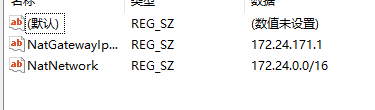

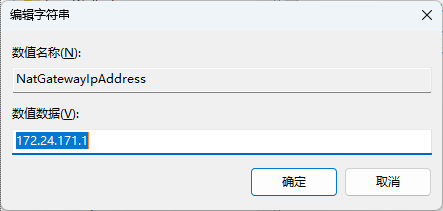

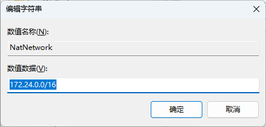

增加开机脚本固定IP

```
@ECHO OFF
chcp 65001 >nul
%1 mshta vbscript:CreateObject("Shell.Application").ShellExecute("cmd.exe","/c ""%~s0"" ::","","runas",1)(window.close)&&exit
setlocal enabledelayedexpansion

:: 关闭所有WSL发行版，不用指定名称避免找不到
wsl --shutdown
timeout /t 1 /nobreak >nul

:: 清理旧IP别名防止重复绑定
wsl -u root ip addr flush label eth0:1 2>nul

:: 检查是否已配置目标IP
wsl -u root ip addr | findstr "172.24.171.242" > nul
if !errorlevel! equ 0 (
    echo WSL已配置固定IP：172.24.171.242
) else (
    wsl -u root ip addr add 172.24.171.242/16 broadcast 172.24.255.255 dev eth0 label eth0:1
    echo WSL固定IP配置成功：172.24.171.242
)

:: Windows虚拟网卡配置同网段IP
ipconfig | findstr "172.24.171.1" > nul
if !errorlevel! equ 0 (
    echo Windows WSL虚拟网卡已配置IP：172.24.171.1
) else (
    netsh interface ip add address "vEthernet (WSL)" 172.24.171.1 255.255.0.0
    echo Windows端虚拟网卡IP配置成功：172.24.171.1
)

echo.
echo 正在测试连通性...
ping 172.24.171.242
pause
```

开机运行脚本

按下快捷键 `Win + R` 打开【运行】窗口 输入（所有用户全局开机启动文件夹）

```
shell:common startup
```

不要直接把 `.bat` 脚本丢进去，建议右键脚本 → 创建快捷方式，把快捷方式粘贴到此文件夹即可

###### 与宿主机共用IP

更新

```
wsl --version
wsl --status
wsl --update
```

`在 C:\Users\你的用户名`）下，新建或编辑一个名为 `.wslconfig`

```
[wsl2]
networkingMode=mirrored
dnsTunneling=true
firewall=true
autoProxy=true

# 开启镜像网络模式（WSL2 不再单独创建独立虚拟子网，
# 直接**复用 Windows 主机的网卡、IP、MAC、网络栈**）
# WSL 内会多出一块`eth1`网卡，IP 和宿主机完全一样（就是你现在看到的`10.10.20.107`）
# WSL 和 Windows 共享同一个 IP 地址
networkingMode=mirrored
# DNS 隧道转发
# WSL 内部 DNS 请求不再自己解析，**全部转发给 Windows 系统的 DNS**
# Windows 切换 Wi‑Fi / 内网 DNS 时，WSL 自动跟着变
#企业内网、VPN 场景下，WSL 能直接解析内网域名，不用手动改 `/etc/resolv.conf`
dnsTunneling=true
# WSL 网络受 Windows 防火墙管控
# 作用：**WSL 里监听的端口，会被 Windows 防火墙规则拦截**。
firewall=true
# 自动继承 Windows 系统代理
# 读取 Windows 系统代理设置（系统代理、PAC 脚本），自动给 WSL 设置代理
autoProxy=true
```

重启 WSL：以管理员身份打开 PowerShell 或命令提示符，运行 `wsl --shutdown`，然后重新启动你的 WSL 发行版

配置防火墙：为了让局域网设备能访问，可能需要在 Windows 防火墙中放行。在管理员 PowerShell 中执行以下命令之一

1. 允许所有入站连接

```
 Set-NetFirewallHyperVVMSetting -Name '{40E0AC32-46A5-438A-A0B2-2B479E8F2E90}' -DefaultInboundAction Allow
```

1. 开放特定端口

```
New-NetFirewallHyperVRule -Name "WSL-Web" -DisplayName "WSL Web Service" -Direction Inbound -VMCreatorId '{40E0AC32-46A5-438A-A0B2-2B479E8F2E90}' -Protocol TCP -LocalPorts 80,443 （将 80,443 替换为你的服务端口）
```
